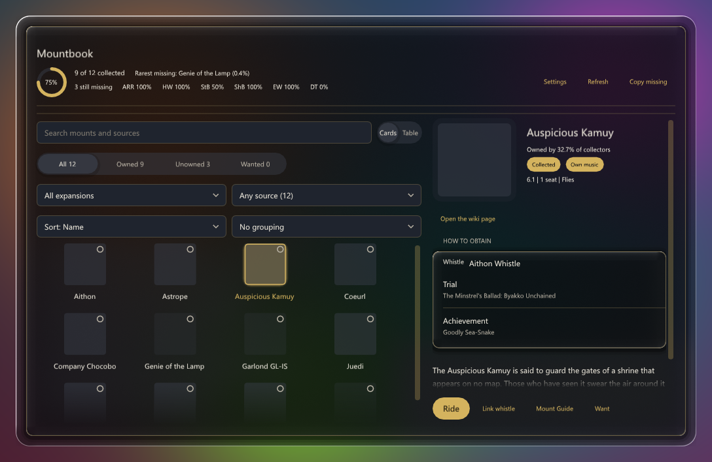
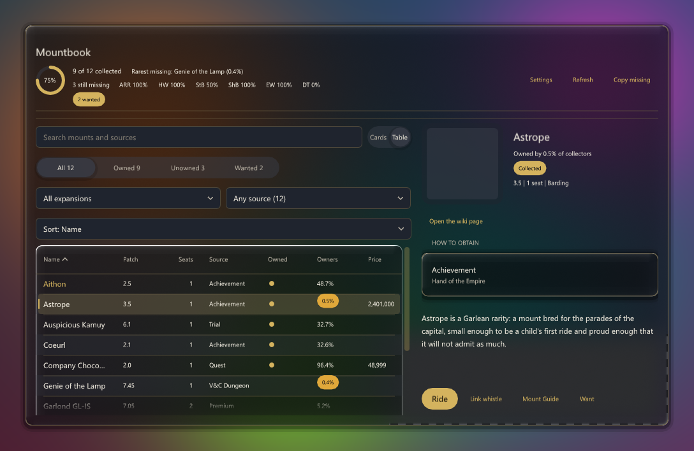
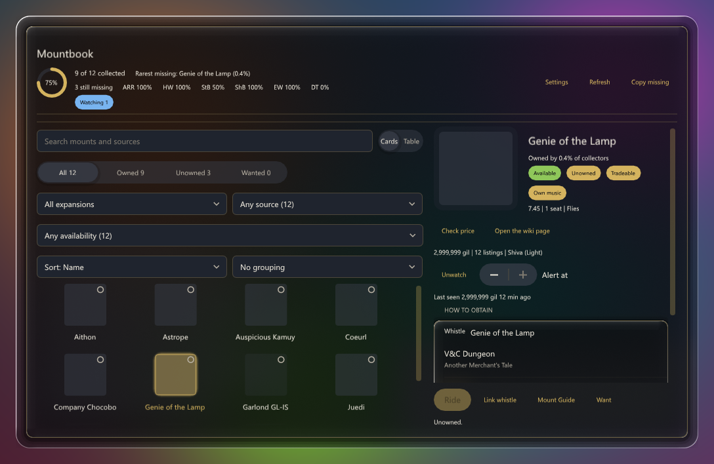
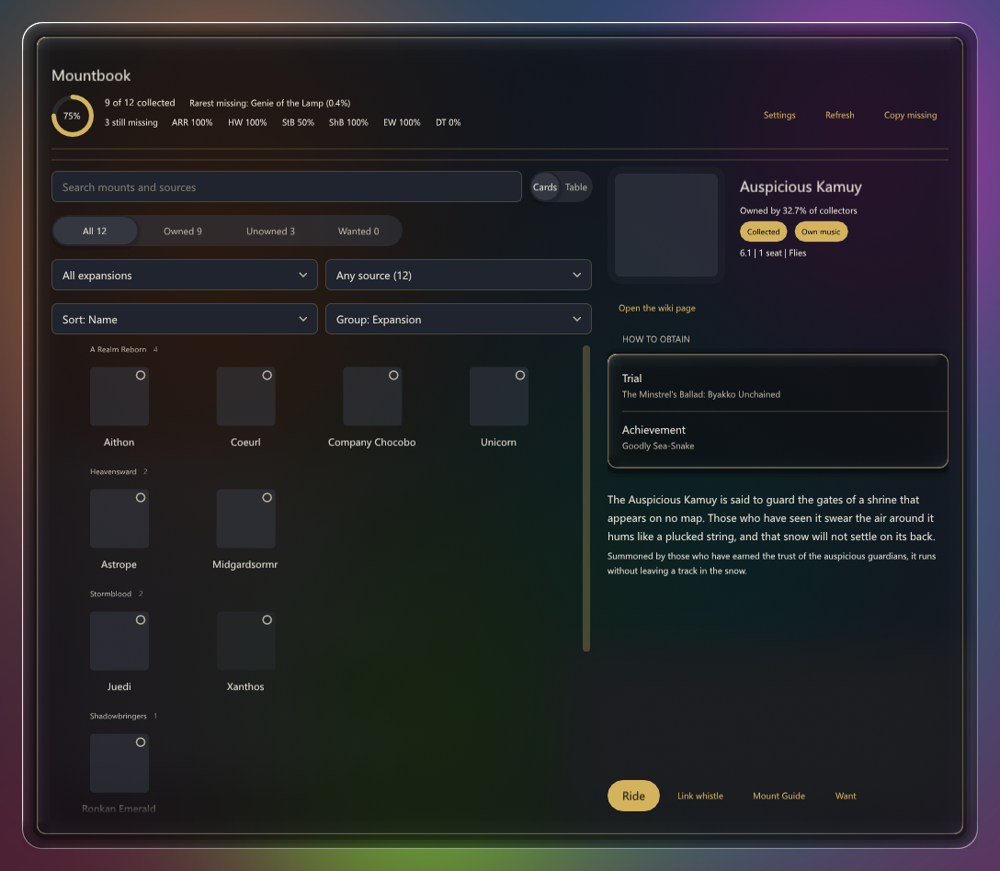
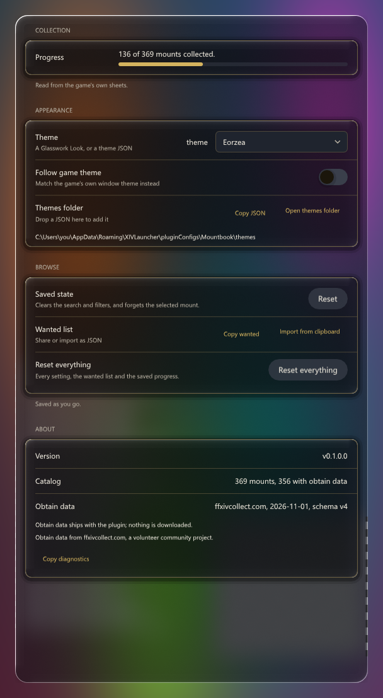
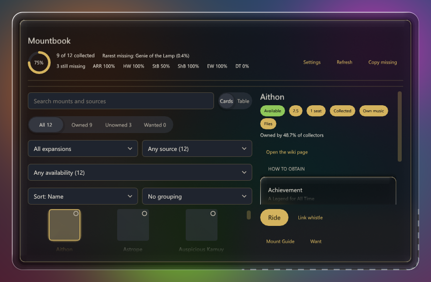

# FFXIV plugins

A [Dalamud](https://dalamud.dev) custom plugin repository for my Final Fantasy XIV plugins.

## Install (in game)

1. Open `/xlplugins` → **Settings** → **Experimental** → **Custom Plugin Repositories**.
2. Add this URL:

   ```
   https://raw.githubusercontent.com/KazimeirzOdnowiciel/ffxiv-plugins/main/repo.json
   ```

3. Save, enable the repository, then install any plugin from the normal plugin list.

Dalamud refreshes `repo.json` on its own schedule; use **Settings → Check for updates** if a new
version does not show up right away.

## Plugins

Ten plugins, all built from this repository. Versions are the ones `repo.json` currently serves.

| Plugin | Version | What it does |
|---|---|---|
| **Mountbook** | 1.0.0.0 | Every mount in the game in one window, as a card grid or a dense sortable table that keeps its heading — and your place in the list — while you scroll. Search with operators (`tradeable:y`, `patch:>=6.1`), filter by expansion, source, availability or ownership, and save a set of filters as a named view. Obtain methods are a named taxonomy of 28 types, and a mount says whether you can get it today (available, seasonal, ranked, premium, legacy). Rarity is a column and a header line ("Rarest missing: …"), grind tracking keeps banked/needed and a note per mount, the wanted board lists what you want with your progress, and a price watch tells you once when a mount crosses your threshold. The detail pane carries the game's artwork and flavour text, community rarity, token prices with your own progress, and a "How to obtain" list whose rows open the wiki page they name. |
| **Slot Yield** | 0.8.0.0 | Treats your retainer slots as a portfolio: scans the market board via Universalis, models how much of each item's daily sales you can actually capture, and picks the items that earn the most gil per slot per day. Also tracks your own listings, alerts on undercuts, plans crafts from your bags, and can reprice or list for you on request. |
| **Roulette Bingo** | 0.1.0.1 | A generated 5×5 bingo card for every duty you enter, filled with the small disasters and rituals of party content. Auto-detects deaths, wipes, vuln stacks and the chat classics; every card is seeded so a code reproduces the same board. |
| **Duty Recap** | 0.0.0.8 | A post-duty scorecard: who died and how often, wipes, chat chatter and peak vuln stacks, graded and compared against your personal best for that duty. |
| **Crit Sound** | 0.1.0.1 | Audio feedback for combat: separate sounds for critical hits, direct hits and crit directs, so you can hear your damage without watching floating text. |
| **Desynth Lens** | 0.4.0.3 | Records what each desynthesis actually returns and what those materials are worth, so you can tell a profitable salvage from a waste of gil. |
| **Gil Ledger** | 0.0.0.2 | A running ledger of your pocket gil: parses market purchases, sales, repairs and venture fees from system chat, and reconciles every balance change the game never explains, with a daily profit-and-loss summary. |
| **Mechanic Watch** | 0.2.0.2 | A party-wide grid of the statuses you choose to care about, so you can see at a glance who has what during a fight. |
| **Crash Trace** | 0.0.0.1 | Names the plugin that throws right before a crash: it logs every first-chance managed exception with its live stack, so the last entry before the crash identifies the culprit. Diagnostic only — it draws nothing, hooks nothing and changes no game state. Leave it on while chasing a crash, then turn it off. |
| **Enemy List Cast Bars** | 1.0.0.1 | Draws a cast bar and the cast name onto each enemy-list row, highlighting interruptible casts. — *third party, MIT, see [credits](#credits)* |

## Screenshots

Mountbook, drawn by its own preview scenes rather than captured from a session: the card grid, the
table, a detail pane with a market price, the grid grouped by expansion, the settings window and the
820×520 minimum size. They are reproducible — one command regenerates all six, and the same command
checks that the committed files are still what the scenes draw — so a screenshot cannot quietly
describe a version that no longer exists. Sizes, provenance and the one command:
[`docs/screenshots.md`](docs/screenshots.md).













## Changelog

[`CHANGELOG.md`](CHANGELOG.md) says what changed for the player, one line per change, version by
version. Each section is the release text: `src/Mountbook/tools/release-notes.ps1` prints the one for
the version being built, and that output is what the GitHub release says. The suite refuses a version
bump that arrives without a section.

Mountbook's 1.0.0 line was released in four steps — 0.2.0 for the window, 0.3.0 for collecting, 0.4.0
for prices and progress, 1.0.0 for the work underneath — so the changelog reads as a history even
though all four came from one tree.

## Repository layout

```
.
├── src/<Plugin>/      plugin sources, one folder per plugin
├── CHANGELOG.md       what changed for the player, one version at a time
├── dist/              release zips + dist/icons/ (this is what Dalamud downloads)
├── icons/             source icons referenced by repo.json
├── repo.json          the repository manifest
└── build.ps1          builds every plugin, packages it, rewrites repo.json
```

A fresh clone is self-contained: every plugin builds from `src/`, with no folders outside the repo.
Mountbook keeps the multi-project shape it was built in — `src/Mountbook`, `.Tests`, `.Previews`,
`.Previews.Cjk` (the CJK golden set) and `.Tools` side by side — and its goldens live in
`src/Mountbook.Previews/goldens`.

## Building

Requires the .NET SDK and a Dalamud installation (API level 15). `Enemy List Cast Bars` declares
.NET 10; the first-party plugins take their target framework from `Dalamud.NET.Sdk`.

```powershell
# build, package and rewrite repo.json
.\build.ps1

# re-package already-built binaries without compiling
.\build.ps1 -NoBuild

# build against a different download root (e.g. the release-asset layout)
.\build.ps1 -BaseUrl "https://github.com/KazimeirzOdnowiciel/ffxiv-plugins/releases/download/latest"
```

A single plugin can be compiled directly:

```powershell
dotnet build src/SlotYield/SlotYield.csproj
```

If Windows refuses the script with *"AuthorizationManager check failed"*, run it in a child process
with an explicit policy instead of changing your machine policy:

```powershell
powershell.exe -NoProfile -ExecutionPolicy Bypass -File .\build.ps1
```

## Verifying Mountbook

Mountbook is the one plugin with a test suite and a golden-image harness, and both gate its release in
CI (`.github/workflows/ci.yml`, which `release.yml` calls as a `needs:` job):

```powershell
dotnet build src/Mountbook/Mountbook.csproj -c Release
dotnet run --project src/Mountbook.Tests/Mountbook.Tests.csproj -c Release
~/.dotnet/tools/glasswork-preview.exe --assembly src/Mountbook.Previews/bin/Release/Mountbook.Previews.dll --compare src/Mountbook.Previews/goldens --out artifacts/previews/Mountbook
```

`dotnet test` does not start in every environment (the test host cannot always get a named pipe), so
`dotnet run` on the xunit project is the portable path. The goldens render on a runner with no GPU —
`windows-latest` reports only "Microsoft Basic Render Driver" and still comes back with 0 differing
pixels — which is why the compare runs inside the release workflow on every push that can ship a
plugin, instead of staying a local habit.

## Releasing

1. Write the version's section in `CHANGELOG.md` (the format is its own preamble; the suite fails a
   bump with no section) and date its heading.
2. Bump `AssemblyVersion` in the plugin's `.csproj` — Dalamud compares this number to decide whether
   an update exists, so an unchanged version is never offered.
3. Run `.\build.ps1`.
4. Commit `dist/` and `repo.json` together with the version bump, **on `main`** — check
   `git status -sb` first, because a release cut on a side branch publishes nothing.
5. Create the GitHub release from the changelog section:
   `src/Mountbook/tools/release-notes.ps1` prints it, so the notes cannot drift from the build.

`repo.json`'s `LastUpdate` field and CRLF line endings in descriptions change on every build. That
is expected; commit the artifacts when the version changes, not on every local build.

## Credits

`Enemy List Cast Bars` is third-party code (MIT), vendored unmodified so the repository stays
self-contained. Provenance and the import path are recorded in
[`src/EnemyListCastBars/NOTICE.md`](src/EnemyListCastBars/NOTICE.md), and notices for code shipped
inside release packages are in [`THIRD-PARTY-NOTICES.md`](THIRD-PARTY-NOTICES.md).

The first-party plugins currently carry no license file; treat them as all rights reserved.
