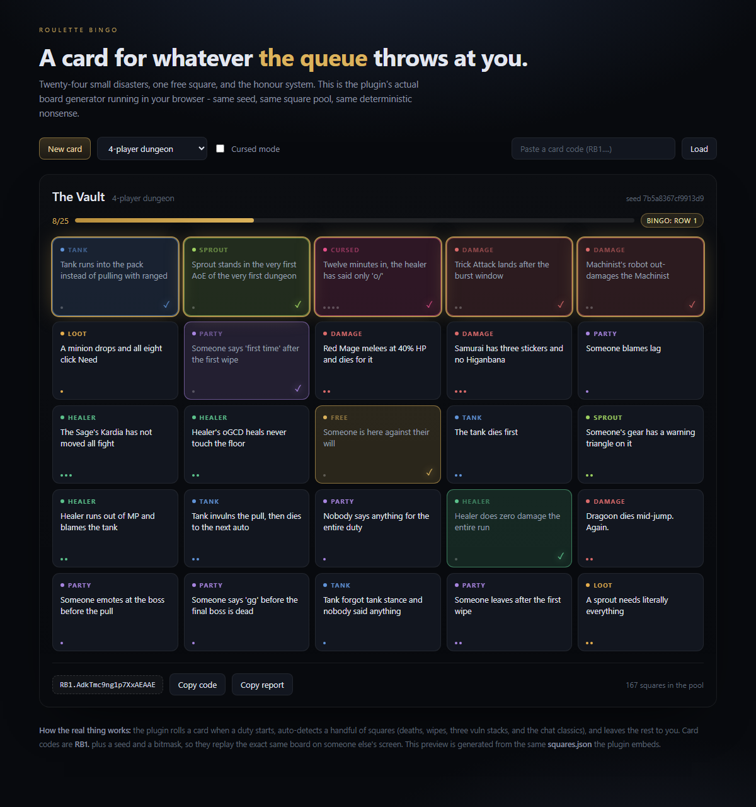

# Roulette Bingo

A Dalamud plugin for Final Fantasy XIV that deals you a 5x5 bingo card for every duty the duty
finder throws at you. Twenty-four squares of small disasters and party rituals, one free space,
and the honour system.



Click squares as they happen. A handful of them the plugin will notice on its own - deaths, wipes,
three vuln stacks, and the chat classics - and the rest you mark yourself, because you were there
and you know what you saw.

Five in a row is a bingo. The report copies to your clipboard as plain text for Discord.

```
ROULETTE BINGO - The Tam-Tara Deepcroft
4-player dungeon | 00:06:00 | 10/25 squares | 2 bingos (Row 1, Column 1)

[X][X][X][X][X]
[X][ ][ ][ ][ ]
[X][ ][X][ ][ ]
[X][ ][ ][ ][ ]
[X][ ][ ][ ][ ]

[X] Someone opens with 'o/'
[X] Sprout watches a cutscene everyone else skipped
[X] Healer dies; the party follows within four seconds
...
Card code: RB1.AYfWEgAAAAAAP5QQAAE
```

## Features

- **A card per duty**, rolled automatically on duty start, in four flavours: 4-player dungeon,
  8-player raid/trial, 24-player alliance raid, and PvP. (The game does not fire the duty-start
  event when you join a run already in progress - `/bingo new` covers that case.)
- **Category-coloured cells** with rarity pips - Common, Uncommon, Rare, and the Cursed squares
  that should probably not be on a card.
- **Honour-system marking** with hover tooltips, plus optional detection for party deaths (by job,
  so the Dragoon square is genuinely earned), wipes, three vulnerability stacks, and party chat
  (`o/`, `gg`, `ty`, `mb`, lag complaints, unanswered questions, total silence).
- **Seeded cards.** A card is a seed. `/bingo code` gives you `RB1....`, a friend pastes it with
  `/bingo load RB1....`, and they get the exact same board.
- **Run report** as ASCII, one click to clipboard, no screenshots required.
- **Compact grid** - a 5x5 dot board small enough to keep open in combat.
- **Cursed mode** - cards built from the deep end of the pool.
- **Your curses** - lifetime stats for the squares you personally mark the most.

## Install (local build)

```
dotnet build -c Release
```

Then either:

- **Dev plugin:** open `/xlplugins` > Dev Tools > "Load plugin from local directory" and point it at
  `bin/Release/`.
- **Manual install:** copy `bin/Release/RouletteBingo/latest.zip` into Dalamud's plugin directory
  and add it through the installer.

The packaged plugin is `bin/Release/RouletteBingo/latest.zip`. It targets Dalamud API 15
(`Dalamud.NET.Sdk/15.0.0`, .NET 10).

## Commands

| Command | What it does |
| --- | --- |
| `/bingo` | Toggle the board |
| `/bingo new` | Roll a fresh card by hand (open world, hunt train, a friend's stream) |
| `/bingo report` | Copy the run report to the clipboard |
| `/bingo code` | Copy the card code |
| `/bingo load <code>` | Load a friend's card, marks and all |
| `/bingo compact` | Toggle the tiny dot grid |
| `/bingo stats` | Say your lifetime numbers out loud in your own chat log |

## Auto-detection

Everything here is optional and can be switched off in `/bingo` > Settings.

| Detector | Fires on |
| --- | --- |
| Party deaths | A party member going from alive to dead. `You die`, `The tank dies first`, `Healer dies...` and the Dragoon square are matched to the job that died. |
| Wipe | The duty wipe event |
| Three vuln stacks | Three or more `Vulnerability Up` statuses on anyone in the party |
| Party chat | `o/`, `gg`, `first time`, `where we going`, `mb`/`sorry`, `ty`, lag complaints, an unanswered question |
| Silence | Finishing the duty with fewer than three party messages |

Detection is best-effort and deliberately conservative: the plugin would rather miss a square than
mark something that did not happen.

## Card codes

`RB1.` + base64url of `version(1) | seed(8, little-endian) | mark mask(4) | kind(1)`.

The seed is FNV-1a over the duty name, territory id, the UTC day and a run counter, so the same
seed always regenerates the same 24 squares - the code is the card.

## The square pool

`Data/squares.json`, embedded into the assembly at build time. 167 squares across Tank, Healer,
Damage, Party, Loot, Sprout, Cursed, PvP and Alliance. Each entry looks like:

```json
{
  "id": "tank-no-mit",
  "text": "Tank pulls wall-to-wall without a single cooldown",
  "cat": "Tank",
  "rarity": "Common",
  "tags": ["dungeon"],
  "auto": null
}
```

- `tags`: empty means "fits any duty"; otherwise `dungeon`, `eightman`, `alliance`, `pvp`.
- `auto`: optional detector id (see `Detection/Detectors.cs`).
- `id` must be unique; `text` should stay under ~78 characters so it fits a cell.

Adding squares is the whole content pipeline - no code changes needed.

## Development

```
dotnet build -c Release

# core logic: pool validation, determinism, line detection, share codes
dotnet run --project tests/CoreTests

# loads the *built* DLL and checks the embedded pool actually made it into the package
dotnet run --project tests/SmokeTest -- bin/Release/RouletteBingo.dll

# browser preview from the same data + logic
python tools/make_demo.py
node tools/check_demo.mjs      # C# <-> JS card parity, via CoreTests --fixtures
node tools/check_demo_ui.mjs   # boots the preview in a fake DOM
```

`./verify.ps1` runs all of it. On a machine with the default execution policy, run it as
`powershell -ExecutionPolicy Bypass -File .\verify.ps1`, and pass `-Python` / `-Node` if those are
not on PATH.

### What is and is not verified

- Core logic, determinism, line detection, share codes: covered by `tests/CoreTests`.
- The packaged DLL actually contains the pool: covered by `tests/SmokeTest`.
- The browser preview matches the plugin card-for-card: covered by `tools/check_demo.mjs`
  (fixtures generated by C#, replayed in JS).
- The in-game windows compile against the real Dalamud 15 assemblies and the API calls were
  checked against the installed `Dalamud.xml`, but they are not screenshot-tested - that needs a
  running game.

### Browser preview

`preview/bingo-demo.html` is standalone - open it, click squares, copy a card code. It is generated
from `Data/squares.json` and a JavaScript port of the generator, and `tools/check_demo.mjs` proves
the two produce identical cards for the same seed.

## Design notes

- **Determinism is the feature.** `System.Random` is not stable across .NET versions, which would
  silently change every shared card code, so the plugin uses its own SplitMix64. The quota table is
  an ordered array rather than a dictionary for the same reason.
- **No automation.** The plugin reads party state and your own chat log, draws a window, and writes
  to your clipboard. It never presses buttons, never moves your character, and never talks in party
  chat unless you tick a checkbox that is off by default.
- **Local only.** No network calls, no telemetry, no account data.

## House rules

Every square is affectionate. The joke is the dungeon, not the person in it - sprouts are doing
fine, mentors are doing their best, and the Dragoon knows what they did.

Party announcements are off by default. If you turn them on, the plugin posts one short line when
you complete a line, and you are the one who chose that.

## Layout

```
RouletteBingo.csproj      Dalamud plugin (API 15)
Plugin.cs                 entry point, commands, services
DutySession.cs            live card, detection, persistence
Configuration.cs          saved settings, history, lifetime stats
Core/                     no Dalamud dependencies, unit-testable
Data/squares.json         the 167-square pool
Detection/Detectors.cs    chat rules, job sets, status ids
UI/                       window, board renderer, theme, settings
tests/CoreTests           xunit-free assertion runner for the core
tests/SmokeTest           loads the packaged DLL
preview/                  generated standalone browser demo
tools/                    demo generator + parity checks
```
